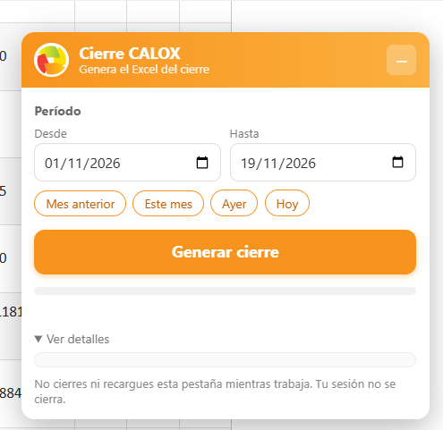

<div align="center">
  
  <h1>Cierre CALOX para Gazpacho</h1>
  <p><strong>Extensión de Chrome v1.0.1</strong> · Genera el Excel de cierre de CALOX desde Gazpacho Mobile con un solo botón.</p>
</div>

<div align="center">
  
  <p><em>Panel de Cierre CALOX dentro de Gazpacho.</em></p>
</div>

---

## Qué hace

La extensión aparece dentro de Gazpacho como un botón flotante **Cierre CALOX**. El usuario elige el período, pulsa **Generar cierre** y obtiene en su carpeta **Descargas** un Excel con las hojas originales de Gazpacho más una hoja nueva llamada **`CIERRE`**.

El proceso es el mismo que se hacía a mano, pero automatizado:

1. Pide a Gazpacho el Excel de pedidos desde la fecha elegida, usando **Guardar en Excel → New Excel**.
2. Lee las hojas de pedidos y productos con las mismas reglas que el cierre manual.
3. Para cada pedido **Web**, remonta la cadena de informes hasta encontrar el original **Móvil** y recupera al **vendedor real** (`Usuario`, `ID de Informe`, `Apertura`).
4. Escribe la hoja **`CIERRE`**, una fila por producto con cantidad, y descarga el archivo final.

> **No pide contraseñas, no inicia sesión y no cierra la sesión del usuario.** Trabaja con la sesión que el usuario ya abrió en Gazpacho.

## Resultado

El archivo generado conserva las hojas originales de Gazpacho y añade `CIERRE`:

| Hoja | Contenido |
|---|---|
| `HOJA DE PEDIDOS CALOX (PARA PED…)` | Pedidos cortos (exportación original) |
| `TABLA DE PEDIDO` | Productos de pedidos cortos (exportación original) |
| `HOJA DE PEDIDOS CALOX (PARA P_2…)` | Pedidos masivos (exportación original) |
| `TABLA DE PEDIDO_3` | Productos de pedidos masivos (exportación original) |
| **`CIERRE`** | **Una fila por producto con cantidad, con vendedor original** |

Nombres de salida:

- Mes completo: `CIERRE OCTUBRE CALOX.xlsx`
- Un día: `CIERRE CALOX 18-11-2026.xlsx`
- Rango: `CIERRE CALOX 17-11-2026 a 18-11-2026.xlsx`

<details>
<summary>Columnas de la hoja CIERRE (18, en este orden)</summary>

`Report ID`, `Open Time`, `First Name`, `Last Name`, `ID de Informe`, `Apertura`, `Usuario`, `External ID`, `DROGUERIA`, `Descripción`, `Material`, `Linea`, `Cantidad`, `Cantidades Pedidas`, `Descuento del Producto %`, `Farmacia`, `Numero de Factura o Pedido`, `Observación`.

No se incluyen `Emp No` ni `Public ID`. El encabezado va en naranja Gazpacho (`#F7941D`) con letra negra en negrita, fila congelada y filtro activo.
</details>

## Características

| Característica | Detalle |
|---|---|
| **Un solo botón** | **Generar cierre** dentro de Gazpacho |
| **Períodos** | **Mes anterior** (por defecto), **Hoy**, **Ayer** o fechas manuales |
| **Vendedor original** | Resuelve pedidos Web buscando el informe Móvil de origen |
| **Sin dependencias para el usuario** | ExcelJS y las reglas ya vienen dentro de `lib/`; no necesita Node, npm ni Python |
| **Reanudación** | Si algo falla o se pulsa **Detener**, no genera un Excel incompleto; al reintentar continúa donde quedó |
| **Ritmo seguro** | Una consulta cada vez, con ~0,5 s de pausa; se detiene ante 401/403/429 o 3 errores seguidos |
| **Sin `eval`** | Respuestas de Gazpacho se leen con un parser propio |
| **Panel aislado** | Interfaz en Shadow DOM; texto dinámico con `textContent` |
| **Sin permisos de Chrome** | Solo se ejecuta en `gazpacho.netalizer.com/gazpachoNG/*` |
| **Archivos limpios** | Sanea caracteres de control Windows-1252 que Gazpacho deja en sus Excel y que hacen que Excel reporte archivos dañados |

## Instalación

1. Descomprime el ZIP entregado en una carpeta fija, por ejemplo `Documentos\Cierre CALOX`. **No borres esa carpeta**: Chrome la necesita.
2. En Chrome, abre `chrome://extensions`.
3. Activa **Modo de desarrollador** (arriba a la derecha).
4. Pulsa **Cargar descomprimida** y elige la carpeta que contiene `manifest.json` (la raíz de este repositorio o la carpeta `extension` del ZIP).
5. Debe aparecer la tarjeta **Cierre CALOX - Gazpacho**. Si Chrome muestra un aviso sobre extensiones en modo desarrollador, pulsa **Mantener**.

## Uso

1. Entra a Gazpacho con tu usuario, como siempre.
2. Abajo a la derecha pulsa el botón **Cierre CALOX**. Si no aparece, pulsa **F5**.
3. Elige el período: **Mes anterior**, **Hoy**, **Ayer** o escribe **Desde** y **Hasta**.
4. Pulsa **Generar cierre**.
5. Espera a que termine. Un mes tarda aproximadamente **5–10 minutos**; un día, alrededor de **1 minuto**.
6. Al terminar, el Excel está en **Descargas**.

Puedes minimizar el panel con **–** y seguir trabajando. **No cierres ni recargues la pestaña de Gazpacho** mientras genera el archivo.

> Al terminar puedes seguir trabajando en Gazpacho o pulsar **Salir**: la extensión nunca cierra tu sesión.

## Privacidad y seguridad

- No guarda credenciales ni tokens propios.
- Usa los servicios oficiales de Gazpacho con la sesión abierta por el usuario; Gazpacho rota sus llaves y la extensión las respeta.
- La descarga del `.xlsx` usa las cookies de la sesión, igual que el botón de Gazpacho.
- No envía datos a servidores externos.
- El Excel generado contiene datos de clientes y vendedores: **no lo compartas fuera del equipo**.

## Solución de problemas

| Situación | Qué hacer |
|---|---|
| No aparece el botón **Cierre CALOX** | Pulsa **F5**. Confirma que estás en `gazpacho.netalizer.com/gazpachoNG/`. |
| Dice *«Primero inicia sesión en Gazpacho»* | Entra con tu usuario y vuelve a pulsar **Generar cierre**. |
| Aparece **Detenido** o errores al consultar | Vuelve a pulsar **Generar cierre**: continúa donde quedó. |
| Gazpacho responde **HTTP 403** o **HTTP 429** | Espera una hora y vuelve a intentarlo. |
| No hay pedidos en el período | Revisa las fechas **Desde** y **Hasta**. |
| Los datos no cuadran | No se genera el archivo para evitar datos incompletos. Avisa a soporte con una captura de **Ver detalles**. |

## Desarrollo

Este repositorio contiene la extensión **lista para cargar**: `manifest.json`, `puente.js`, `cierre-calox.js`, el logo y `lib/`.

Las **reglas del cierre** no se editan aquí: viven en `src/transform/` del proyecto principal (`Gazpacho Scraping`) y se generan con:

```bash
npm run build:extension   # regenera lib/cierre-core.js y copia ExcelJS
npm run test:unit         # build + 30 pruebas unitarias, sin entrar a Gazpacho
```

Tras cambiar el código, en Chrome pulsa **⟳** en `chrome://extensions` y recarga Gazpacho con **F5**. Sube la versión en `manifest.json` antes de entregar una actualización.

### Estructura

```text
.
├── manifest.json              # Declaración de la extensión (Manifest V3)
├── cierre-calox.js            # Panel, flujo en Gazpacho y descarga
├── puente.js                  # Puente al "mundo" de la página
├── logo_gazpacho.png          # Icono del botón y de la tarjeta
├── panel-cierre-calox.png     # Captura del panel mostrada en el README
└── lib/
    ├── cierre-core.js         # Reglas del CIERRE (generadas)
    ├── exceljs.bare.min.js    # ExcelJS para navegador
    └── exceljs-LICENSE.txt    # Licencia de ExcelJS
```

## Licencia

Uso interno. La licencia formal está pendiente de definir con la organización.
